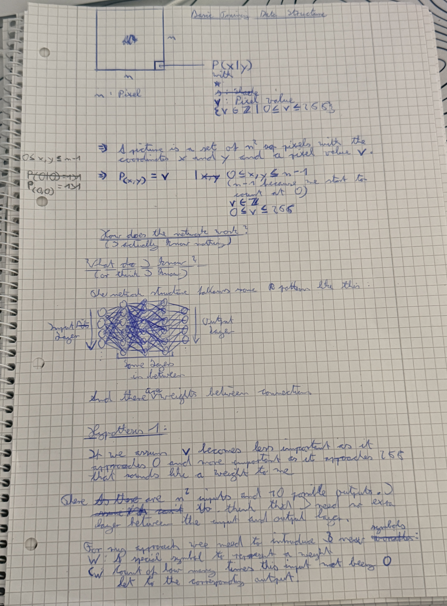
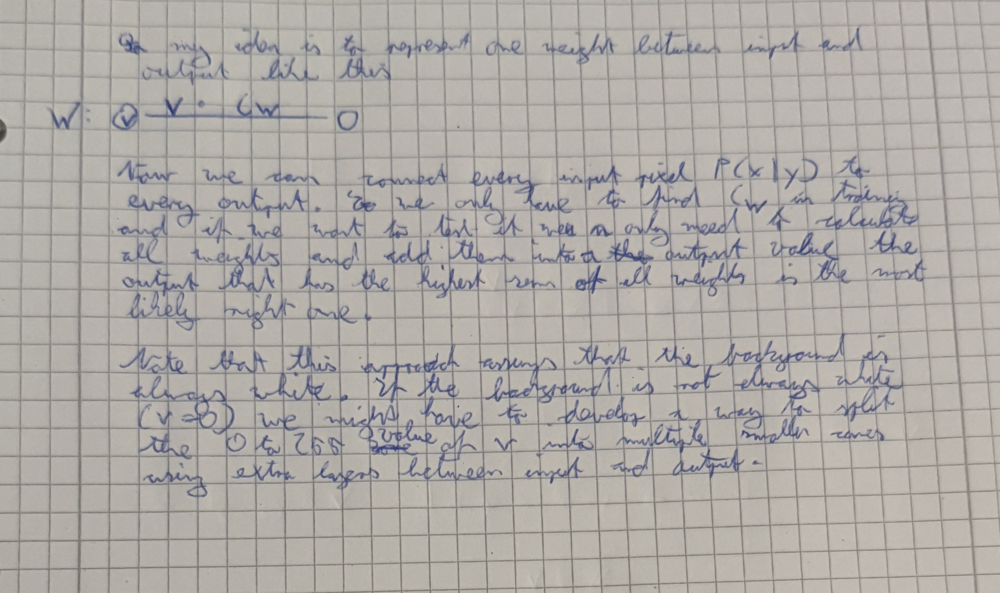

# 2026-10-20_to_24

Okay, so after understanding the file structure a bit better, I decided not to continue with coding for now and to focus on how I think such a digit recognition model might actually work. Since I did that over the period of a few days, I don't have detailed notes on what I actually did. But I want to share how I came to my conclusion and what thought process it took to get there.

---

So the first goal was to bring the picture data into a mathematical shape and introduce some variable names I can use in the future. From the documentation of the dataset, we know that the picture is 28 pixels high and wide. So I introduced the variable `n`, which stands for the pixel count of one side of the picture. Every pixel can be represented using a point `P` and the corresponding x and y coordinates `=> P(x|y)`. Every pixel also has a value `v`, which represents the gradient from 0 (white) to 255 (black).

=> A picture is a set of n2 pixels with coordinates x and y and a pixel value `v`

=> P(x,y) = v
&nbsp;|&nbsp; 0 ≤ x,y ≤ n − 1
&nbsp;|&nbsp; v ∈ ℤ
&nbsp;|&nbsp; 0 ≤ v ≤ 255

(We use n − 1 because we start counting the pixels at 0, not at 1, and have to normalize that.)

So this might be a bit too abstract and complicated, and not fully mathematically correct or written correctly, but I understand it, and it helped me keep the prerequisites in mind.

---

After writing that, I went on to think about what I actually know (or think I know) about how such a recognition system works.

First, I think the network follows a structure that has an input layer and an output layer, which are connected through some layers in between. Every layer has multiple neurons, and every neuron in one layer is connected to all neurons in the neighboring layers. Also, every connection between two neurons has a specific weight, which determines how important the connection is. I also know that such networks use matrices. But there is a catch: I haven't learned matrices in school yet. So this information is useless. It has to work without them, right? Right?! Or maybe I'll just accidentally find out how they work without knowing?

---

So after defining the shape of the data and how everything in it connects, and summarizing what I think I already know, I started with my first hypothesis of how I could implement the network. So here it is:

### Hypothesis 1
If we assume that `v` becomes less important as it approaches 0 and more important as it approaches 255, that sounds like the weights I mentioned earlier.

Because I think the problem is not that complex, and for my research and testing purposes, I don't think I'll need extra layers between the input and output layers. I have an approach in mind in case this is not true, but that's not for now.

So to explain my approach/hypothesis, we need to introduce 2 new symbols:
- `W`: A special symbol to represent a weight.
- `C``W`: Count of how many times this input not being 0 led to the corresponding output.

My idea is to calculate one weight for every connection between neurons with this formula: `v * C``W`

Now we can connect every input neuron corresponding to a single pixel `P` to every output neuron. When training the model, we need to increase the count `C``W` when the corresponding output of the weight is right. So when we test the model, we can pass the value `v` of point `P` into the formula for our weights and sum up all weights for every output neuron. The output neuron with the highest sum is (in my theory) the most likely to be the right output.

There are some assumptions and things that could be problematic. First, the approach assumes that the background of the images is always white, or at least always the same. If this is not the case, I might need to develop a way to split different values of `v` into more zones using one or more extra layers between input and output.

---

Now I have to implement all of that in real Rust code. See the next log (2026-10-24).

---

### My notes

